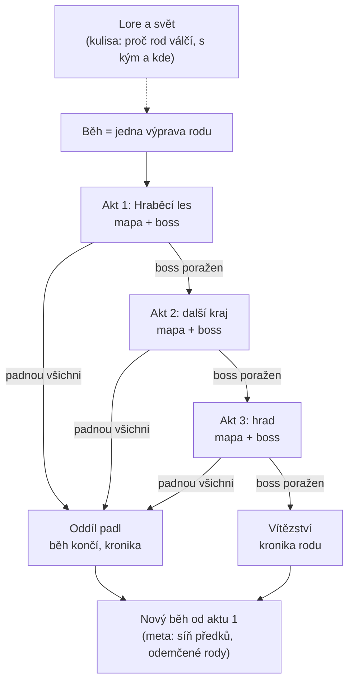
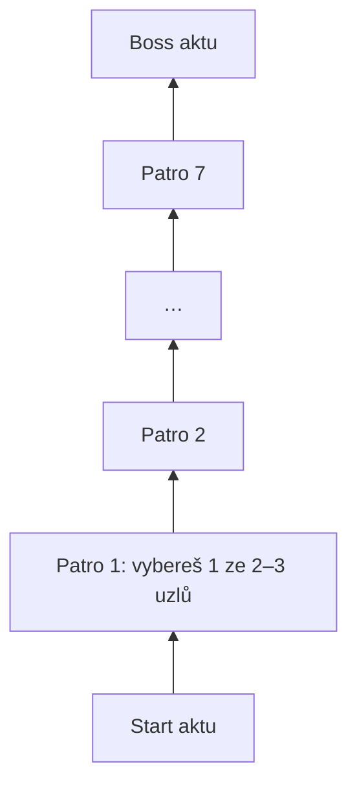

# Jak hráč postupuje hrou (zjednodušeně)

Schváleno 29.10.2026. Podrobnosti v `rozhodnuti.md`.

## Uvnitř aktu

- **Akt** = jedna mapa, 7 pater, nahoře boss.
- **Patro** = vrstva mapy. Jdeš jednou cestou: na každém patře navštívíš jeden uzel, ostatní vynecháš.
- **Uzel** = zastávka: bitva, elita (těžší, lepší odměna), událost (rozhodnutí s cenou), tábor (odpočinek), boss.
- **Co se nese dál:** hrdinové, pasivky, přísahy, nástupci padlých, sláva, kronika (a zranění, pokud se tak rozhodne).
- **Dvě různé smrti:** padlý hrdina = běh pokračuje s nástupcem. Padne celý oddíl = konec běhu, další začíná od aktu 1.
